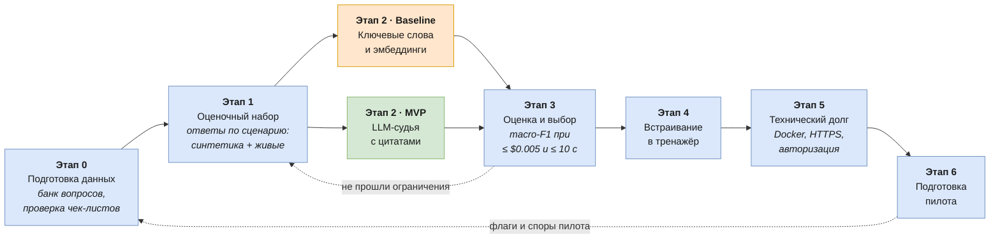

# ML System Design Doc
## Дизайн ML-системы: автоматическая проверка устных ответов на ML-собеседованиях (MVP)

*Структура по шаблону [ML System Design Doc от Reliable ML](https://github.com/IrinaGoloshchapova/ml_system_design_doc_ru/blob/main/ML_System_Design_Doc_Template.md).*

> ### Термины
> - **Вопрос** — открытый вопрос из банка, как на собеседовании.
> - **Эталонный ответ** — развёрнутый правильный ответ; показывается пользователю после ответа и служит контекстом
>   для проверки.
> - **Чек-лист (рубрика)** — список ключевых тезисов, которые должен раскрыть кандидат; по нему считается доля
>   раскрытых тезисов.
> - **Ответ кандидата** — расшифровка устного ответа или текст пользователя.
> - **Результат проверки** — вердикт по каждому тезису (раскрыт / раскрыт частично / не раскрыт) с цитатой из ответа,
>   доля раскрытых тезисов и список фактических ошибок в ответе.
> - **Оценочный набор** — ответы кандидатов с заранее известным правильным результатом проверки; служит для измерения
>   качества проверяющей модели, а не для обучения.
> - **Ответ по сценарию** — ответ, специально составленный так, чтобы раскрыть заданные тезисы, пропустить остальные
>   и допустить заданные ошибки; правильный результат проверки для него известен по построению.

### 1. Цели и предпосылки

#### 1.1. Зачем идём в разработку продукта?

**Бизнес-цель**

Дать кандидатам на ML-позиции объективную обратную связь на устные ответы на открытые вопросы собеседования
при самостоятельной подготовке, без участия эксперта. Основная аудитория — junior и middle; для senior полезна
часть с теоретическими вопросами. Первая итерация ограничена ML/DS: автор сам готовится к ML-собеседованиям,
а пилотная аудитория доступна напрямую. Подход не зависит от предметной области,
поэтому расширение на другие IT-направления — вопрос новых банков вопросов, а не новой системы.

Продукт: веб-тренажёр с банком вопросов, голосовыми ответами и интервальными повторениями; в перспективе —
B2C-подписка. Цель текущей итерации — MVP автоматической проверки и пилот на первых пользователях.

**Почему станет лучше, чем сейчас, от использования ML**

Сейчас у кандидата три способа проверить открытый ответ, и у каждого есть проблема:

- **самопроверка по эталону** (в тренажёре это ручной режим с рубрикой) необъективна: кандидаты склонны засчитывать
  себе пункты, которые раскрыли частично;
- **мок-собеседование с экспертом** дорогое и требует договорённостей, поэтому бывает редко;
- **разовые вопросы универсальному чат-ассистенту** не дают системы: нет банка вопросов, единых критериев
  от раза к разу и истории прогресса.

Без ML свободный устный ответ не проверить: сравнение по ключевым словам не засчитает пересказ своими словами
и засчитает названный, но неверно объяснённый термин. ML-система (распознавание речи + сопоставление ответа
с чек-листом ключевых тезисов по смыслу) даёт разбор за секунды, по одинаковым критериям и с цитатами из ответа,
так что каждое замечание можно проверить.

**Что будем считать успехом итерации с точки зрения бизнеса**

1. **Качество:** macro-F1 вердиктов по тезисам на отложенной части оценочного набора (см. 2.1) не ниже порога,
   который фиксируется после первых замеров. Отдельно проверяется, что на живых ответах качество
   не сильно ниже, чем на синтетических.
2. **Доверие:** пилотные пользователи не оспаривают результат проверки не меньше чем в 80% проверенных ответов.
3. **Вовлечённость:** не меньше половины пилотных пользователей возвращаются на второй неделе.
4. **Экономика:** расходы на проверку ответов на одного активного пользователя не превышают 20% предполагаемой
   цены подписки (расчёт — в разделе 1.2).

Пороги в пунктах 2–4 — гипотезы автора до первых замеров; они пересматриваются по результатам EDA и пилота.

#### 1.2. Бизнес-требования и ограничения

**Бизнес-требования**

1. Пользователь отвечает на открытый вопрос голосом (основной режим) или текстом (когда говорить неудобно:
   шумное место, транспорт) и получает разбор: какие тезисы чек-листа раскрыты, раскрыты частично или не раскрыты
   и какие фактические ошибки есть в ответе. Каждый засчитанный тезис подкреплён цитатой из ответа. Проверка
   текстового и голосового ответа одинаковая, для голоса добавляется этап распознавания речи.
2. Разбор появляется не позже чем через 10 секунд после окончания ответа для 95% проверок (без учёта времени,
   пока пользователь правит расшифровку), чтобы не ломать темп тренировки.
3. Повторная проверка того же ответа даёт тот же результат.
4. Пользователь может оспорить вердикт по отдельному тезису с указанием причины. Спор сохраняется как сигнал
   качества проверки.
5. Пользователь может пометить вопрос или чек-лист как ошибочный (флаг).
6. Если проверка недоступна (нет ключа, сбой провайдера, исчерпан бюджет), тренажёр продолжает работать в ручном
   режиме с рубрикой.

**Бизнес-ограничения**

- **Стоимость.** Переменные расходы на проверку — не больше 20% цены подписки. При гипотезе цены около 500 ₽
  (~$5) в месяц и около 200 открытых ответов на активного пользователя в месяц (10 в день × 20 дней) это
  не больше **$0.005 за ответ** (распознавание + модель). Цена подписки — гипотеза, её проверяет опрос в пилоте.
- **Бюджет пилота.** 15 пользователей × 200 ответов × $0.005 — не больше $15 на месяц пилота.
- **Данные.** Размеченных ответов кандидатов нет, а автор не эксперт и не может надёжно размечать ответы сам.
  Поэтому оценочный набор строится по сценарию: ответ заранее задумывается так, чтобы раскрыть одни тезисы чек-листа,
  пропустить другие и ошибиться в третьих, и правильная разметка известна по построению. Основа — несколько сотен
  синтетических ответов от LLM (другой, чем проверяющая модель, чтобы не завышать качество), плюс несколько десятков
  живых голосовых ответов по сценарию от автора и знакомых — для проверки, что качество на живой речи не хуже,
  чем на синтетике. Споры пилотных пользователей с проверкой необъективны в обе стороны: пользователь может оспорить
  верный вердикт в свою пользу и не оспорить ошибочно завышенный. Поэтому они используются для мониторинга,
  но не как правильные ответы.
- **Контент.** Вопросы и чек-листы сгенерированы LLM ([промпт](PROMPT_FOR_QUESTION_CHAT.md)). Полная экспертная
  проверка банка до запуска не проводится; качество доводится в ходе пилота через флаги пользователей и выборочную
  проверку отмеченных вопросов.
- **Приватность.** Голос и тексты ответов передаются внешнему провайдеру моделей с запретом на их хранение
  и обучение на них (настройка `data_collection: deny` в OpenRouter). Аудио на нашей стороне не сохраняется.
- **Ресурсы.** Разработка силами одного человека в рамках семестра.

**Что ожидаем от итерации**

Работающий MVP проверки с измеренным на оценочном наборе качеством, сравнение нескольких подходов к проверке
и пилот на 5–15 пользователях.

**Бизнес-процесс пилота**

Пилотные пользователи (студенты курса, коллеги и знакомые, готовящиеся к собеседованиям) получают бесплатный доступ
на 3–4 недели. Они проходят ежедневные сессии и отвечают на открытые вопросы голосом или текстом. При несогласии
с проверкой оспаривают вердикт по тезису и помечают флагом ошибочные вопросы. В конце пилота — короткий опрос: польза,
готовность платить и сколько.

**Критерии успешного пилота и пути развития**

Пилот успешен, если выполнены критерии из раздела 1.1: не меньше 80% проверок без споров, возвращаемость
на второй неделе от 50%, стоимость в пределах ограничения.

- **Пилот успешен** → расширение аудитории и агентный сценарий: уточняющие вопросы по упущенным тезисам, как
  у реального интервьюера (шаг к голосовому AI-интервьюеру).
- **Пользователи часто оспаривают вердикты** → разбор причин (ошибки распознавания, ошибки в чек-листах или ошибки
  модели проверки) и следующая итерация по главной причине.
- **Качество есть, а возвращаемости нет** → проблема в продукте, а не в ML: пересматриваем сценарий использования.

#### 1.3. Что входит в скоуп проекта/итерации, что не входит

**Какие бизнес-требования закрываем в этой итерации**

Все требования из 1.2: проверка голосовых и текстовых ответов по чек-листу с цитатами, ограничения по времени
и стоимости, стабильность результата, возможность оспорить вердикт по тезису и пометить вопрос, ручной режим при сбое.

Технически итерация включает:

- оценочный набор: ответы на открытые вопросы с правильной разметкой каждого тезиса чек-листа (раскрыт / раскрыт
  частично / не раскрыт) и списком заложенных ошибок, полученной по сценарию: синтетические ответы от LLM и живые
  голосовые ответы автора и знакомых; часть набора откладывается для финального замера;
- сравнение подходов к проверке на оценочном наборе: бейзлайн без LLM и несколько вариантов с LLM, включая проверку
  по эталонному ответу целиком, без чек-листа;
- выбор подхода по качеству, стабильности, стоимости и задержке;
- логирование для оценки пилота: задержка, стоимость, споры пользователей с проверкой;
- интерфейс результата проверки: вердикты по тезисам с цитатами, доля раскрытых тезисов, кнопка «Оспорить»
  у каждого тезиса с выбором причины;
- веб-версия для пилотных пользователей: развёртывание на сервере с HTTPS (нужен для доступа к микрофону
  в браузере) и авторизацией, доступ с компьютера и телефона через браузер.

**Что не будет закрыто**

- Агентный сценарий с уточняющими вопросами — кандидат на следующую итерацию; в этой — максимум один уточняющий
  вопрос по упущенному тезису, если останется время.
- Вопросы по другим IT-направлениям, кроме ML/DS.
- Полная экспертная проверка банка вопросов.
- Проверка моделью карточек: у них нет чек-листа, они остаются в режиме самопроверки.
- Оплата и подписка: в пилоте доступ бесплатный.
- Связь результата проверки с расписанием повторений и пересмотр планировщика (FSRS) — отдельная часть продукта
  со своей методологией. В итерации сохраняется текущий способ: доля раскрытых тезисов переводится в оценку
  для планировщика по порогам.
- Персонализация выбора вопросов.
- Нативное мобильное приложение и Telegram-бот.

**Качество кода и воспроизводимость**

- Код в публичном репозитории; линтер и форматтер ruff, проверки pre-commit, тесты pytest.
- Сравнение подходов воспроизводится одной командой на оценочном наборе; модели, версии промптов и параметры
  фиксируются.
- Оценочный набор (синтетические и живые ответы по сценарию) хранится в репозитории.
- Сервис запускается одной командой через Docker — одинаково на сервере пилота и локально у ревьюеров.

**Планируемый технический долг**

- SQLite вместо полноценной СУБД: достаточно для пилота на 15 человек, но не для масштабирования.
- Нет очереди проверок: запросы к модели идут напрямую из веб-обработчика.
- Нет автоматического мониторинга с алертами: метрики пилота смотрятся вручную.
- Зависимость от одного провайдера моделей (OpenRouter).

#### 1.4. Предпосылки решения

- **Объект оценки и гранулярность.** Оценивается один ответ кандидата на один вопрос. Решение принимается по каждому
  тезису чек-листа (раскрыт / раскрыт частично / не раскрыт), доля раскрытых тезисов вычисляется из вердиктов
  с весами 1, 0.5 и 0 соответственно. Фактические ошибки в ответе выделяются отдельным списком. Так разбор
  объясним: видно, какие тезисы не засчитаны и почему.
- **Что проверяется моделью.** Только открытые вопросы: у каждого есть чек-лист. Тесты, сопоставления
  и последовательности проверяются без ML; карточки (без чек-листа) и задачи на код — самопроверкой.
- **Входные данные.** Из банка вопросов: вопрос, эталонный ответ, чек-лист (3–6 тезисов). От пользователя: ответ
  кандидата — текст или расшифровка речи, которую пользователь может поправить перед проверкой.
- **Чек-лист — критерий оценки.** Допущение: чек-лист отражает тезисы, которые ожидал бы услышать интервьюер. Тезисы
  проверяются по смыслу, а не по словам. Верные утверждения вне чек-листа отмечаются в разборе, но на оценку
  не влияют; их частота отслеживается как признак неполного чек-листа. Ошибочные чек-листы выявляются флагами
  пользователей.
- **Распознавание речи — внешний сервис.** Качество распознавания отдельно не оценивается; его влияние видно
  по разнице качества проверки на живых голосовых и синтетических ответах и по доле расшифровок, поправленных
  пользователями.
- **Язык.** Ответы на русском с английскими терминами, в том числе в искажённом произношении.
- **Режим работы.** Онлайн: проверка запускается сразу после ответа.
- **Модели не обучаются на данных пользователей.** Используются готовые модели через API; улучшение — смена модели
  или промпта после проверки на оценочном наборе.
- **Спор с результатом проверки.** Пользователь может оспорить вердикт по отдельному тезису, указав причину
  (ошибка распознавания, неверный чек-лист, модель не поняла ответ). Вердикты модели и споры сохраняются; доля
  оспоренных проверок — метрика доверия.
- **Проверка отделена от расписания повторений.** Проверка оценивает полноту и верность ответа; как её результат
  используется планировщиком повторений — отдельная часть продукта (см. 1.3).

### 2. Методология

#### 2.1. Постановка задачи

**Тип задачи.** Многоклассовая классификация пар «тезис чек-листа — ответ кандидата» по трём классам: раскрыт /
раскрыт частично / не раскрыт, с извлечением подтверждающей цитаты из ответа. Дополнительно — выделение фактических
ошибок в ответе и генерация короткого разбора. По смыслу задача близка к распознаванию логического следования (NLI):
следует ли тезис из ответа кандидата.

- **Вход:** вопрос, эталонный ответ, чек-лист из 3–6 тезисов, ответ кандидата (текст или расшифровка речи).
- **Выход:** для каждого тезиса — класс, цитата и комментарий; список фактических ошибок с признаком грубой ошибки;
  разбор в 1–3 предложения.
- **Доля раскрытых тезисов** вычисляется правилом, а не моделью: (раскрытые + 0.5 × раскрытые частично) / число
  тезисов. Её и вердикты по тезисам видит пользователь.

**ML-метрики и связь с бизнесом.** Все метрики качества считаются на оценочном наборе: на одной его части подбираются
промпты и пороги, на отложенной делается финальный замер.

| Метрика | Что показывает | Связь с бизнес-критерием |
|---|---|---|
| Macro-F1 по трём классам на уровне тезисов (основная) | качество вердиктов; macro — потому что классы несбалансированы и пропуски тезисов не должны теряться за частым классом «раскрыт» | качество (1.1, п. 1) |
| Средняя абсолютная ошибка доли раскрытых тезисов | насколько итог, который видит пользователь, отличается от правильного | доверие (1.1, п. 2) |
| Доля цитат, дословно найденных в ответе | галлюцинации в разборе | доверие (1.1, п. 2) |
| Стабильность: доля совпадающих вердиктов при повторной проверке | одинаковые критерии от раза к разу | бизнес-требование 3 |
| Стоимость проверки и задержка (95-й перцентиль) | экономика и темп тренировки | экономика (1.1, п. 4), бизнес-требование 2 |

**Что сравниваем.**

- **Бейзлайн 1 (без ML):** ключевые слова тезиса ищутся в ответе с лемматизацией (`pymorphy3`) и нечётким сравнением
  строк (`rapidfuzz`, устойчиво к ошибкам распознавания); доля найденных слов и два порога дают три класса.
- **Бейзлайн 2 (ML без LLM):** тезис и предложения ответа переводятся в эмбеддинги мультиязычной моделью предложений
  (`sentence-transformers`); максимальное косинусное сходство тезиса с предложениями ответа и два порога дают
  три класса.
- **MVP (LLM-судья):** модель получает вопрос, эталон, чек-лист и ответ и возвращает вердикты с цитатами. Варианты
  для сравнения: весь чек-лист одним запросом, каждый тезис отдельным запросом, проверка по эталонному ответу
  без чек-листа, несколько прогонов с голосованием; модели разной цены.

Выбирается подход с лучшим macro-F1 среди укладывающихся в ограничения по стоимости и задержке. Самопроверка
пользователя — текущий процесс, который заменяется (см. 1.1), а не технический бейзлайн: её нельзя
воспроизвести на оценочном наборе.

#### 2.2. Блок-схема решения

Бейзлайн и MVP различаются только на этапе построения модели проверки (этап 2), остальные этапы общие, поэтому
решение показано одной схемой: синие этапы общие, оранжевый — бейзлайн, зелёный — MVP. Пунктирные стрелки —
возвраты на ранние этапы по итогам контрольных точек. Содержание этапов — в таблице под схемой.

| Этап | Что делаем | Результат |
|---|---|---|
| 0. Подготовка данных | Выборочная проверка чек-листов банка вопросов (сгенерированы LLM) автором, исправление найденных ошибок | Банк вопросов с проверенной выборкой чек-листов |
| 1. Оценочный набор | Сценарии ответов: какие тезисы раскрыть, какие пропустить, где ошибиться. Синтетические ответы в устном стиле от LLM другого семейства, чем судья; живые голосовые ответы автора и знакомых по тем же сценариям. Деление на часть для подбора и отложенную часть | Ответы с правильными вердиктами по тезисам и списком заложенных ошибок |
| 2. Baseline | Ключевые слова тезиса в ответе: лемматизация (`pymorphy3`) и нечёткое сравнение (`rapidfuzz`). Эмбеддинги: косинусное сходство тезиса с предложениями ответа (`sentence-transformers`). Два порога, подобранные на части для подбора, дают три класса | Вердикты по тезисам без LLM |
| 2. MVP | LLM-судья получает вопрос, эталон, чек-лист и ответ и возвращает вердикты с цитатами, ошибки и разбор. Варианты: чек-лист целиком, по тезису, по эталону без чек-листа, голосование нескольких прогонов; модели разной цены. Наличие цитат в ответе проверяется кодом | Вердикты по тезисам с цитатами |
| 3. Оценка и выбор | На отложенной части: macro-F1 по тезисам, ошибка доли раскрытых тезисов, доля найденных цитат, стабильность, стоимость, задержка | Выбранный подход: лучший macro-F1 при стоимости до $0.005 и задержке до 10 с |
| 4. Встраивание | Вердикты по тезисам с цитатами в интерфейсе, «Оспорить» по тезису, логирование стоимости, задержки и споров, ручной режим при сбое | Тренажёр с новой проверкой |
| 5. Технический долг | Docker, сервер с HTTPS, авторизация | Сервис, доступный пилотным пользователям |
| 6. Подготовка пилота | Набор 5–15 пользователей на 3–4 недели, метрики из 1.1, опрос о пользе и цене | Готовый к запуску пилот |
